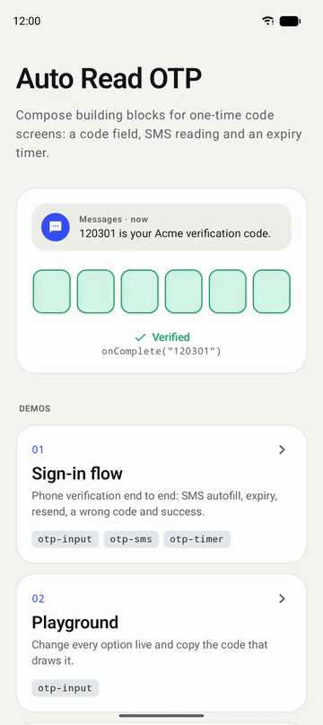
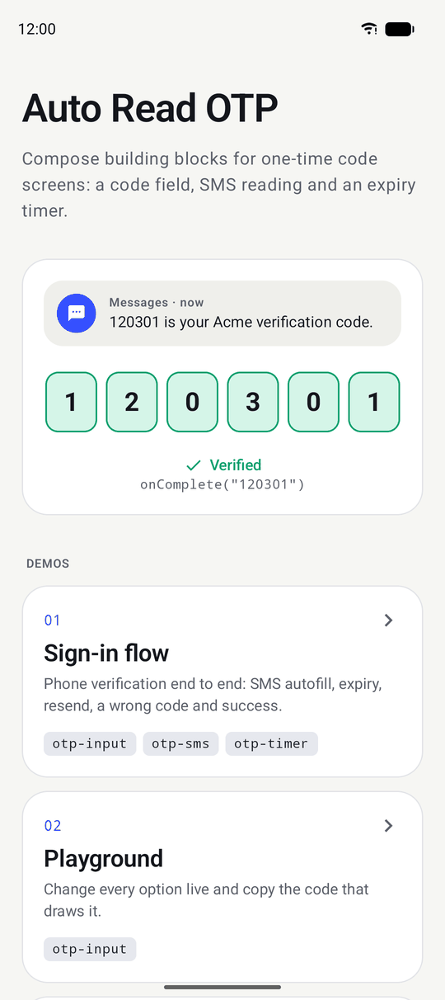
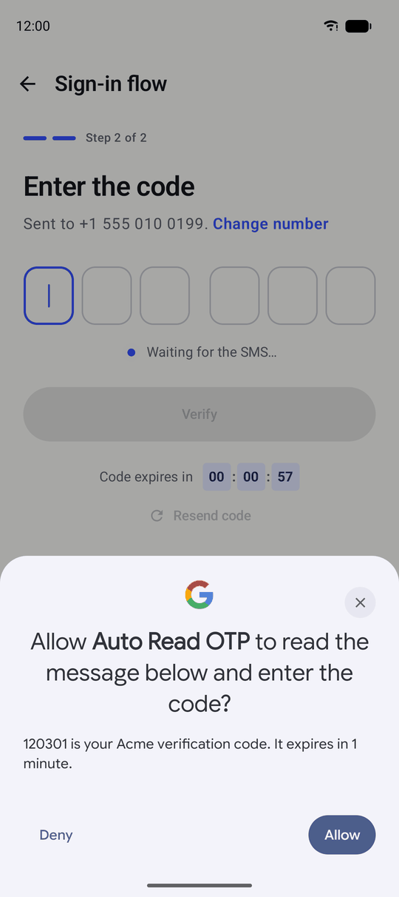
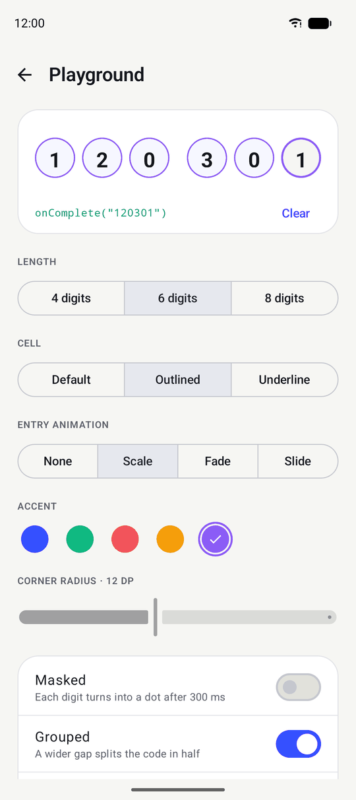
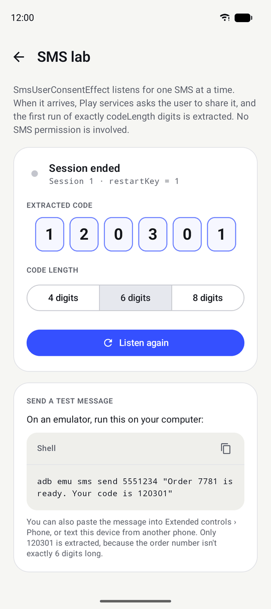
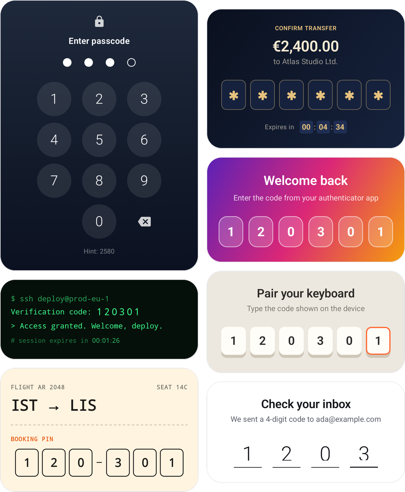

# Auto Read OTP

[](https://central.sonatype.com/namespace/io.github.burkido)
[](https://github.com/burkido/auto-read-otp/actions/workflows/ci.yml)
[](LICENSE)

Jetpack Compose building blocks for one-time code screens: an OTP input with a cell per digit, automatic SMS reading through Google's SMS User Consent API, and a countdown timer for code expiry.

<p align="center">
  
</p>

<p align="center"><sub>A real SMS sent to an emulator. The user taps Allow once, and the code fills itself in.</sub></p>

<p align="center"><a href="#designs-from-the-gallery"><b>See seven designs built with it ↓</b></a></p>

| Artifact | What it gives you |
|---|---|
| `otp-ui` | `OtpInputField` with default, outlined and underline cells, masking, autofill and screen reader support, plus `CountdownTimer`, a `HH : MM : SS` countdown that hides itself when time is up |
| `otp-sms` | `SmsUserConsentEffect`, which reads the code from the next SMS after the user agrees. No SMS permission needed |
| `otp-bom` | Keeps both on matching versions |

API reference: [burkido.github.io/auto-read-otp](https://burkido.github.io/auto-read-otp/)

## Installation

The libraries are on Maven Central, so no extra repository is needed. They require `minSdk` 24, `compileSdk` 37 and Jetpack Compose.

In `gradle/libs.versions.toml`:

<!-- x-release-please-start-version -->
```toml
[versions]
otp = "3.0.0"

[libraries]
otp-bom = { module = "io.github.burkido:otp-bom", version.ref = "otp" }
otp-ui = { module = "io.github.burkido:otp-ui" }
otp-sms = { module = "io.github.burkido:otp-sms" }
```
<!-- x-release-please-end -->

In your module's `build.gradle.kts`, add only the parts you use:

```kotlin
dependencies {
    implementation(platform(libs.otp.bom))
    implementation(libs.otp.ui)
    implementation(libs.otp.sms)
}
```

Without a version catalog:

<!-- x-release-please-start-version -->
```kotlin
dependencies {
    implementation(platform("io.github.burkido:otp-bom:3.0.0"))
    implementation("io.github.burkido:otp-ui")
    implementation("io.github.burkido:otp-sms")
}
```
<!-- x-release-please-end -->

Coming from 2.0.0? `otp-input` and `otp-timer` are now one artifact, `otp-ui`. Coming from 1.x? Coordinates, packages and several APIs changed. The [migration guide](docs/MIGRATION.md) covers both.

## A complete verification screen

```kotlin
@Composable
fun VerifyScreen(onVerify: (String) -> Unit, onResend: () -> Unit) {
    val code = rememberTextFieldState()
    var attempt by rememberSaveable { mutableIntStateOf(0) }
    var canResend by rememberSaveable { mutableStateOf(false) }
    var expiresAt by rememberSaveable { mutableLongStateOf(System.currentTimeMillis() + 2.minutes.inWholeMilliseconds) }
    val timer = rememberCountdownTimerState(endTimeMillis = expiresAt)

    OtpInputField(
        state = code,
        otpLength = 6,
        onComplete = onVerify,
    )

    SmsUserConsentEffect(
        codeLength = 6,
        onCodeReceive = { received -> code.fillOtp(received, 6) },
        onError = { error -> Log.w("Verify", "No code from SMS: $error") },
        restartKey = attempt,
    )

    CountdownTimer(state = timer, onTimerFinish = { canResend = true })

    TextButton(
        enabled = canResend,
        onClick = {
            code.clearOtp()
            attempt++
            expiresAt = System.currentTimeMillis() + 2.minutes.inWholeMilliseconds
            canResend = false
            onResend()
        },
    ) {
        Text("Resend code")
    }
}
```

## Sample app

The [`sample`](sample) module shows each part of the library on its own and all of them working together. It's the quickest way to see what the library can do before you write any code.

<table>
  <tr>
    <td align="center" width="25%"></td>
    <td align="center" width="25%"></td>
    <td align="center" width="25%"></td>
    <td align="center" width="25%"></td>
  </tr>
  <tr>
    <td align="center"><b>Home</b></td>
    <td align="center"><b>Sign-in flow</b></td>
    <td align="center"><b>Playground</b></td>
    <td align="center"><b>SMS lab</b></td>
  </tr>
</table>

- **Sign-in flow** is a full phone verification: enter a number, get a code, verify it. The code fills in from an SMS, the timer counts down, and once it runs out you can ask for a new code. Wrong codes shake the field. A small demo panel at the bottom shows the server's code and lets you simulate the SMS, enter a wrong code, or skip to the last five seconds, so you can try every state without a phone.
- **Playground** lets you change the length, cell style, entry animation, accent color, corner radius, masking, grouping, placeholder, error and enabled state, and see the result right away. Below the preview is the exact Kotlin code for what's on screen, ready to copy.
- **Gallery** has seven designs, from a lock screen keypad to a terminal prompt. Each one is a single `OtpInputField` with its own look. See [Designs from the gallery](#designs-from-the-gallery).
- **SMS lab** shows every step of the consent flow as it happens: when listening starts, the code that was received, and any error. It also lists every error you can get and gives you a ready-made test message to send.

### Running it

Open the project in Android Studio and run the `sample` configuration, or from the command line:

```bash
./gradlew :sample:installDebug
```

SMS reading needs Google Play services, so use a device or an emulator image that includes Google APIs or the Play Store. The sign-in demo doesn't make any network calls. Its "server" is a stub that makes up a code each time, so you can try it anywhere.

## OTP input

```kotlin
val code = rememberTextFieldState()

OtpInputField(
    state = code,
    otpLength = 6,
    onComplete = { otp -> viewModel.verify(otp) },
)
```

The field only accepts ASCII digits and never holds more than `otpLength` of them, however the text arrives. Pasting "Your code is 123-456" leaves `123456`. `onComplete` runs when the last digit goes in. It doesn't run again for a value restored after rotation or process death, so the code isn't submitted twice.

Useful helpers on `TextFieldState`: `fillOtp(code, length)`, `clearOtp()`, `otpValue` and `isOtpComplete(length)`.

### Cell styles

Pass a `cell` to switch the look. The built-in cells are `DefaultOtpCell`, `OutlinedOtpCell` and `UnderlineOtpCell`.

```kotlin
OtpInputField(state = code, otpLength = 6) { cell ->
    UnderlineOtpCell(state = cell)
}
```

`cell` receives an `OtpCellState` with `index`, `char`, `isFilled`, `isFocused`, `isError` and `isEnabled`, so you can draw anything you like. Here's a terminal-style cell that shows an underscore for empty slots and a block where the cursor is:

```kotlin
OtpInputField(state = code, otpLength = 6) { cell ->
    Box(contentAlignment = Alignment.Center, modifier = Modifier.size(width = 14.dp, height = 24.dp)) {
        when {
            cell.isFilled -> Text(cell.char.toString(), fontFamily = FontFamily.Monospace)
            cell.isFocused -> Box(Modifier.size(width = 10.dp, height = 18.dp).background(Color.Green))
            else -> Text("_", fontFamily = FontFamily.Monospace)
        }
    }
}
```

### Designs from the gallery

<p align="center">
  
</p>

These designs come from the sample app's gallery. Each one is a single `OtpInputField`. If you see a look you like, the source is short enough to copy:

| Design | How it's built |
|---|---|
| [Lock screen](sample/src/main/kotlin/com/burkido/otp/sample/gallery/LockScreenDesign.kt) | A custom dot cell, filled from an on-screen keypad through the `String` overload |
| [Vault](sample/src/main/kotlin/com/burkido/otp/sample/gallery/VaultDesign.kt) | `DefaultOtpCell` with dark colors and masking, plus a matching `CountdownTimer` |
| [Aurora](sample/src/main/kotlin/com/burkido/otp/sample/gallery/AuroraDesign.kt) | `DefaultOtpCell` with see-through colors on a gradient |
| [Terminal](sample/src/main/kotlin/com/burkido/otp/sample/gallery/TerminalDesign.kt) | A custom cell with a blinking block cursor, and a green `CountdownTimer` |
| [Keycaps](sample/src/main/kotlin/com/burkido/otp/sample/gallery/KeycapsDesign.kt) | A custom cell that springs down like a key when a digit goes in |
| [Ticket](sample/src/main/kotlin/com/burkido/otp/sample/gallery/TicketDesign.kt) | `OutlinedOtpCell` with a dash in the `separator` slot and a monospace font |
| [Minimal](sample/src/main/kotlin/com/burkido/otp/sample/gallery/MinimalDesign.kt) | `UnderlineOtpCell` with large type and a slide-up entry |

### Customizing

Every style value comes from `OtpInputDefaults`, and each function lets you override just what you need:

```kotlin
OtpInputField(
    state = code,
    otpLength = 6,
    isError = uiState.wrongCode,
    placeholder = "-",
    colors = OtpInputDefaults.colors(focusedBorderColor = Color(0xFF00D4FF)),
    dimensions = OtpInputDefaults.dimensions(cellWidth = 52.dp, cellHeight = 60.dp),
    animationSpec = OtpInputDefaults.animationSpec(cellEntryAnimation = CellAnimation.SlideUp),
    maskConfig = OtpInputDefaults.maskConfig(isMasked = true),
    separator = { afterIndex -> if (afterIndex == 2) Text("-") else Spacer(Modifier.width(8.dp)) },
)
```

Setting `isError` to true shakes the cells once. Masking shows each digit briefly, then replaces it with a dot.

### String based state

If your screen state is a plain `String`, for example in a ViewModel, use the value overload. Every value you get back is already filtered.

```kotlin
OtpInputField(
    value = uiState.code,
    onValueChange = viewModel::onCodeChange,
    otpLength = 6,
)
```

### Autofill and accessibility

The field is marked as an SMS one-time code, so keyboards such as Gboard can offer a code from a new message even without `otp-sms`. Screen readers announce the field once instead of cell by cell, and masked fields are exposed as passwords so the digits aren't read aloud.

## Reading the code from SMS

```kotlin
SmsUserConsentEffect(
    codeLength = 6,
    onCodeReceive = { received -> code.fillOtp(received, 6) },
    onError = { error -> /* see below */ },
)
```

When the next SMS arrives, Play services asks the user whether your app may read it. If they agree, the first run of exactly `codeLength` digits is passed to `onCodeReceive`. Other numbers in the message, like an order number, are skipped. The app needs Google Play services, but no SMS permission.

Each session handles one message. After a code, an error or the five minute timeout, change `restartKey` to listen again, for example when the user taps "Resend". Pass `senderPhoneNumber` to only react to messages from that number.

`onError` receives a `SmsConsentError`:

| Error | Meaning |
|---|---|
| `StartFailed` | Play services couldn't start listening, usually because it's missing or outdated. `cause` has the details |
| `Timeout` | No message arrived within five minutes |
| `ConsentDenied` | The user closed the consent sheet |
| `PromptUnavailable` | The consent sheet couldn't be shown on this device |
| `CodeNotFound` | The message had no code with `codeLength` digits |
| `UntrustedIntent` | A broadcast pretended to come from Play services and was ignored. Listening continues |

### Testing on an emulator

You don't need a second phone. While your screen is listening, send the emulator a message from your computer:

```bash
adb emu sms send 5551234 "Your code is 120301"
```

You can also paste a message into the emulator's Extended controls › Phone. A few things to know:

- The emulator image needs Google Play services. Images labeled "Google APIs" or "Google Play" have it.
- The consent sheet can take a few seconds to show up after the message arrives.
- Play services doesn't ask about messages from people in your contacts, so send from a number that isn't saved.

The SMS lab in the sample app is a good place to try this. It shows each event as it happens.

### Security

The broadcast receiver requires Play services' send permission, so other apps can't fake the "SMS retrieved" broadcast. The consent intent inside it is only launched after checking that it opens the Play services consent screen and grants no URI access, as Google recommends. The library adds a `<queries>` entry for Play services to your merged manifest so that check works on Android 11 and later.

## Countdown timer

`CountdownTimer` is part of `otp-ui`.

```kotlin
val timer = rememberCountdownTimerState(duration = 5.minutes)
// or, with an expiry time from your backend:
val timer = rememberCountdownTimerState(endTimeMillis = response.expiresAt)

CountdownTimer(
    state = timer,
    style = CountdownTimerDefaults.style(textSize = 18.sp),
    onTimerFinish = { canResend = true },
)
```

The remaining time is worked out from the clock, so the timer stays correct after the screen is left and revisited or the process is recreated. Screen readers hear "4 minutes, 32 seconds remaining" instead of a row of numbers.

## Using with AI coding agents

This repository ships an [agent skill](skills/auto-read-otp/SKILL.md) that teaches coding agents the current API, the pitfalls of SMS consent and the migration from 1.x. It follows the [Agent Skills](https://agentskills.io) standard. Claude Code, Codex and Gemini CLI install it from the latest release, so it describes the newest version on Maven Central, and it checks which version your project uses before suggesting newer APIs.

### Claude Code

```bash
claude plugin marketplace add burkido/auto-read-otp
claude plugin install auto-read-otp@auto-read-otp
```

To get new releases, run `claude plugin update auto-read-otp@auto-read-otp`, or turn on auto-update under **Marketplaces** in `/plugin`.

### Codex

```bash
codex plugin marketplace add burkido/auto-read-otp
```

Then install **auto-read-otp** from the plugin directory. Run `codex plugin marketplace upgrade` to pick up new releases.

### Cursor

```bash
cursor-agent plugin marketplace add https://github.com/burkido/auto-read-otp
```

Then run `cursor-agent`, open `/plugin`, and install **auto-read-otp** from the Marketplace tab.

### Gemini CLI

```bash
gemini extensions install https://github.com/burkido/auto-read-otp --auto-update
```

### Android Studio, claude.ai and other agents

Every [release](https://github.com/burkido/auto-read-otp/releases) attaches an `auto-read-otp.zip`. Upload it to claude.ai under **Settings > Capabilities > Skills**, or unzip it into your project's skills directory:

| Agent | Directory |
|---|---|
| Android Studio | `.agent/skills/` |
| Claude Code | `.claude/skills/` |
| Codex, GitHub Copilot and others that read `.agents/skills` | `.agents/skills/` |

## Contributing

Bug reports and pull requests are welcome. See [CONTRIBUTING.md](CONTRIBUTING.md) for how to build, test and name your changes.

## License

MIT. See [LICENSE](LICENSE).
